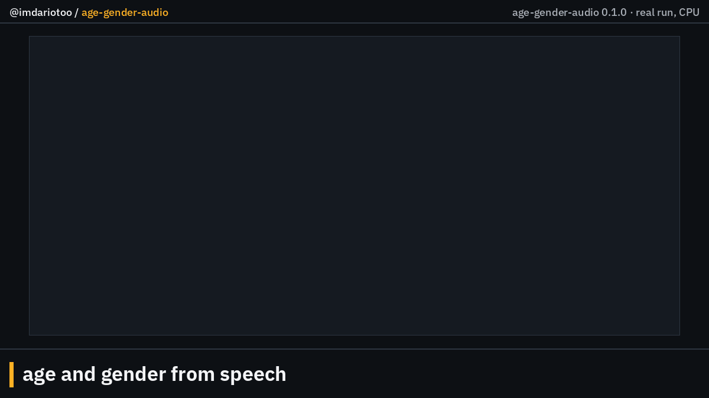

# age-gender-audio

Age and gender from speech with permissively licensed weights: a frozen `facebook/wav2vec2-base` backbone with trained age and gender heads, shipped as an int8 ONNX model. It returns the same output shape as `audeering/wav2vec2-large-robust-24-ft-age-gender` (embedding, age 0..1, gender probabilities [female, male, child]), so it can stand in where that checkpoint is loaded. The `child` probability is **not predicted** (no permissive child-speech corpus; the entry exists only for shape compatibility).

![Held-out Common Voice 17 English, n=1,200 speakers: int8 ONNX minus the audeering checkpoint, gender accuracy +0.92 pp [-0.17, +2.00], age MAE -0.55 yr [-1.10, +0.02]: level with it, not claimed to beat it](https://raw.githubusercontent.com/riceharvest/age-gender-audio/main/docs/hero-r4.png)

*Hero: paired difference on the held-out set (source: [`r4/result.md`](https://github.com/riceharvest/age-gender-audio/blob/main/r4/result.md)). Both intervals reach zero: the wording is "level with", never "beats". Losses and what is not measured are in [Results](#results-scoped-010).*

## Install

    pip install https://github.com/riceharvest/age-gender-audio/releases/download/v0.1.0/age_gender_audio-0.1.0-py3-none-any.whl

Not on PyPI yet; install from the GitHub release.

## Usage

    age-gender-audio FILE.wav [FILE2.wav ...] --model PATH/model_int8.onnx    # or set AGE_GENDER_AUDIO_ONNX

One JSON line per file: `{"file", "age_years", "gender", "gender_probs"}`. The ONNX files are built with `pip install 'age-gender-audio[export]'` then `python -m age_gender_audio.export OUTDIR` (tested with transformers 4.57.6, torch 2.15.0, onnx 1.23.2, onnxruntime 1.32.0; the extra pins `transformers>=4.57,<5` and the export fails fast outside it; see the [R4 README](https://github.com/riceharvest/age-gender-audio/blob/main/r4/README.md)). Python: `from age_gender_audio import AgeGenderModel`.

## Results, scoped (0.1.0)

0.1.1 is a patch: it ships the same int8 file (sha256 `71436e54...65df`, identical to 0.1.0) and the same heads (`5bf33806...cc5a`, unchanged since v0.1.0). The fp32 file was re-exported under a pinned transformers (`3a28b86f...1bc4`); the fp32 row below was measured on the earlier `d9d7d004...` build and has not been re-scored on R4. No new held-out run was made for 0.1.1. Details: [CHANGELOG](https://github.com/riceharvest/age-gender-audio/blob/main/CHANGELOG.md).

Setup for every row: Common Voice 17 English (CC0), one clip per speaker, first 10 s of audio, age scored against the decade-bucket midpoint (so age MAE has a floor from bucket width), gender scored as 2-way female/male. Our heads are trained on Common Voice (in-domain); the incumbent never saw CV-en (out-of-domain). Both sets are stratified, not population draws. "Incumbent" is `audeering/wav2vec2-large-robust-24-ft-age-gender` (CC-BY-NC-SA-4.0).

**Held-out R4 gate (n=1200 speakers, list sha256 `90d1c69b...fe07`, frozen before any model number, paired bootstrap 2000 resamples, seed 20261124).** Source: [`r4/result.md`](https://github.com/riceharvest/age-gender-audio/blob/main/r4/result.md), raw [`r4/gate_r4.json`](https://github.com/riceharvest/age-gender-audio/blob/main/r4/gate_r4.json), reproduce commands in the [R4 README](https://github.com/riceharvest/age-gender-audio/blob/main/r4/README.md).

| arm (held-out, n=1200) | gender acc | age MAE (yr) | gender diff vs incumbent (pp, 95% CI) | age MAE diff (yr, 95% CI) |
|---|---|---|---|---|
| incumbent | 0.9492 | 9.741 | - | - |
| ours fp32 | 0.9600 | 9.177 | +1.08 [+0.00, +2.17] | -0.565 [-1.113, +0.018] |
| ours int8 (shipped) | 0.9583 | 9.192 | +0.92 [-0.17, +2.00] | -0.550 [-1.096, +0.024] |
| control: majority gender / mean age | 0.7642 | 11.151 | - | - |

Gate (pre-registered): gender diff CI lower bound >= -2.0 pp, age diff CI upper bound <= +1.0 yr: PASS for fp32 and int8; int8-vs-fp32 parity PASS (gender -0.17 pp, age +0.015 yr). **Wording: ours is level with the incumbent on this set. We do not claim it beats the incumbent: every paired CI includes 0 or has its bound at 0 (int8 gender [-0.17, +2.00]; int8 age [-1.096, +0.024]).** The incumbent predicts `child` as top class on 10/1200 clips, ours on 0/1200 (child is untrained). Set composition: male 917 / female 283; skewed to ages 25-35 ([R4 README](https://github.com/riceharvest/age-gender-audio/blob/main/r4/README.md)), so do not read the accuracies as population figures.

**Dev-set R2 screen (n=600, speaker-disjoint; spent: also used to pick the int8 recipe, so not held-out for the shipped model).** Source: lab repo `results/age-gender-audio/r2/result.md`, review PASS `results/age-gender-audio/r2/review.md`; int8 parity file [`r4/int8_parity_screen600_spent_set.json`](https://github.com/riceharvest/age-gender-audio/blob/main/r4/int8_parity_screen600_spent_set.json).

| arm (dev-set, n=600) | gender acc | age MAE (yr) |
|---|---|---|
| incumbent | 0.9500 | 9.812 |
| ours fp32, seed 0 | 0.9467 | 10.383 |
| ours fp32, seed 1 | 0.9450 | 10.336 |

Losses on this set: ours was nominally behind the incumbent on both arms (gender -0.33 / -0.50 pp, age MAE +0.571 / +0.523 yr, upper CI +1.415 / +1.337 yr against a +1.5 yr limit). Allowed wording from the PASS review: within the pre-registered margin of the incumbent; never "beats". The held-out R4 result above came out nominally ahead; both are "level with", and the difference between the two sets is not evidence of improvement.

**Incumbent reference census (dev-set R1, n=438 speakers, incumbent only).** Source: lab repo `results/age-gender-audio/r1/result.md`: strict 3-way gender accuracy 97.49%, age MAE 9.87 yr, 6/438 adult clips predicted child. Different clips from the R2/R4 sets, so not comparable with the tables above.

**int8 vs fp32 build evidence (dev-set, spent R2 screen n=600, [`r4/README.md`](https://github.com/riceharvest/age-gender-audio/blob/main/r4/README.md)).** Gender accuracy 0.9467 -> 0.9450 (-0.17 pp), age MAE 10.383 -> 10.472 yr (+0.089 yr). int8 quantizes only the 60 transformer-layer weight matmuls; the model file is 209,118,507 B (fp32 378,448,513 B for the 0.1.0 build; the 0.1.1 fp32 file is 378,448,514 B).

**Not measured:** other languages, children, noisy or telephone audio, speakers outside CV17-en, non-binary gender, CPU latency. No claim is made for them.

## Licences

| | code | backbone | trained on | NC clause |
|---|---|---|---|---|
| age-gender-audio (this repo) | MIT | `facebook/wav2vec2-base`, Apache-2.0 | Common Voice 17 English, CC0 | none |
| `audeering/wav2vec2-large-robust-24-ft-age-gender` | n/a | `facebook/wav2vec2-large-robust` | agender, Common Voice, TIMIT, VoxCeleb2 (per its card) | CC-BY-NC-SA-4.0 (HF API licence field, read 2026-11-21) |

This is the reason the repo exists: the audeering checkpoint is the one most people pull (2,348,522 downloads in the 30 days to 2026-11-21 per the HF API) and its licence is non-commercial. This table is not legal advice; read the licence texts for your case.

## Intended use and privacy

Age and gender inferred from a voice are personal data. Intended use: self-hosted or on-device call analytics and dataset annotation, with the consent and notice your jurisdiction requires. Not for: surveillance, identity verification, hiring, insurance or credit decisions, or any use on children (the model has no child class and was not trained on or tested with children). The output is an estimate, not a fact about a person: age is regressed against self-reported decade buckets, gender is the 2-way female/male label in Common Voice. Nothing in this repo sends audio anywhere; inference is a local ONNX file.

## Claims rules (honest numbers — keep this section)

- Every number in this README is produced by a command that is quoted next to it (or linked to its result file). No invented, rounded-up or extrapolated numbers.
- Dev-set numbers are labelled **dev-set** everywhere they appear. Held-out numbers say which frozen split, n, and seed produced them.
- "Beats X" only with a paired confidence interval whose lower bound is > 0, under X's own documented setup; otherwise the word is "level with". Losses are shown, not buried.
- Benchmarks link the exact reproduce command and the reader/scorer version.
- No AI credit in commits, code or docs (the commit-msg hook strips AI co-author trailers; the pre-push hook blocks them and scans for secrets).

## Development

    pip install -e . pytest
    python -m pytest -q

CI runs the same tests on every push/PR (`.github/workflows/ci.yml`).
Hooks: `git config core.hooksPath hooks` (done by the scaffold; see `hooks/README.md`).

## License

MIT — see LICENSE.